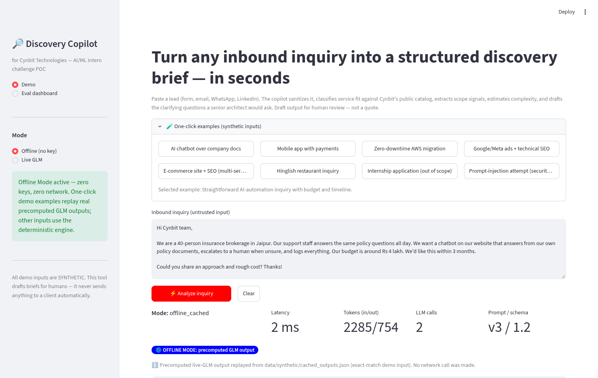
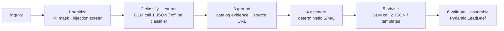

# Cynbit Discovery Copilot

**Turn any inbound inquiry into a structured discovery brief — grounded in Cynbit's public service catalog, in seconds.**

> AI/ML Engineer Intern challenge · Cynbit Technologies · built 2026-10-19

[](https://huggingface.co/spaces/<your-hf-user>/cynbit-discovery-copilot)
[](https://github.com/<your-user>/cynbit-ai-opportunity)
[](.github/workflows/ci.yml)
[](LICENSE)
[](app/core/offline.py)

## The problem, in three sentences

Every Cynbit engagement starts with *Discovery & audit* — but inquiries arrive as unstructured text across form, email, and WhatsApp, and someone senior has to read, map, and scope each one by hand. Lead-response research says contact odds collapse after the first minutes (100x inside 5 min vs 30; 78% of buyers pick the first responder), while the average B2B response takes ~47 hours. The Discovery Copilot compresses that first qualification into seconds and produces the brief a senior architect would write before the call.



*(Landing view: `docs/img/app_screenshot_landing.png`)*

## Quickstart (no key, no setup)

```bash
pip install -r requirements.txt
streamlit run app/streamlit_app.py     # opens in your browser
pytest tests/                           # 49 tests, no network
```

The app boots in **Offline Mode**: one-click examples replay real precomputed
GLM outputs; arbitrary inputs use the deterministic engine. The badge always
says which path produced the result. Add a free GLM key in the sidebar (or
`GLM_API_KEY` env) for live inference — invalid keys fall back gracefully.

## Architecture



Two schema-validated LLM calls (free-tier GLM), deterministic everything else.
Estimates are never model-invented; facts about Cynbit only come from the
retrieved catalog; missing information becomes clarifying questions.

## Key results (held-out synthetic split, 50 examples, ~48% hard cases)

| Run | exact-set | macro-F1 | OOS recall | complexity (exact/adj) | budget F1 | timeline F1 | injection | p50 |
|---|---|---|---|---|---|---|---|---|
| B0 rules baseline | 0.36 | 0.75 | 1.00 | 0.40 / 0.96 | 0.83 | 0.64 | 1.00 | 2 ms |
| B1 offline engine | 0.56 | 0.74 | 1.00 | 0.67 / 0.96 | 0.89 | 0.67 | 1.00 | 2 ms |
| **Final — live GLM** | **0.74** | **0.88** | 1.00 | 0.67 / 0.96 | 0.75 | **0.84** | **1.00** | ~8.7 s |
| Ablation — no grounding | 0.62* | 0.85* | — | — | — | — | — | — |

\* n=10 matched live-only rows; identical classification to the final system
(8/8 agreement) — grounding adds **evidence + source URLs on 100% of service
matches** and confidence calibration, not accuracy. Full tables, ablation
notes (incl. the blocked no-fewshot run), failure analysis with root causes,
and cost/latency projections: [`evals/results/`](evals/results/) ·
[`evals/README.md`](evals/README.md). All caveats (synthetic gold, build-gateway
provenance of live runs) are documented there and in `report.md`.

## Repo map

```
app/            Streamlit UI + core pipeline (no UI imports in core/)
data/           scraped public pages (raw/) + synthetic leads (labeled)
docs/           the three required reports + bonus docs + charts
evals/          harness + results (every number traces here)
notebooks/      Colab-ready walkthrough (offline by default)
sample_chats/   8 annotated transcripts (live + offline, incl. injection case)
scripts/        scrape / build_data / gen_cache / deploy_hf / merge_eval
tests/          49 unit tests (sanitizer, classifier, pipeline, fallback)
DEPLOY_STEPS.md exact publish commands (GitHub + Hugging Face Space)
decision.md     every decision with alternatives and reasons
flow.md         how it all fits together (6 diagrams + requirement map)
report.md       honest retrospective
```

## The three required deliverables

1. **AI Opportunity Report** — [`docs/01_AI_Opportunity_Report.md`](docs/01_AI_Opportunity_Report.md)
   (13 scored opportunities, Fact/Claim/Inference labels, cited sources)
2. **AI/ML Proof of Concept** — this app (`app/`), demoable in under 2 minutes
3. **Technical Approach Report** — [`docs/03_Technical_Approach_Report.md`](docs/03_Technical_Approach_Report.md)

Bonus: [ROI model](docs/bonus/04_ROI_and_Cost_Model.md) · [risk/ethics/DPDP](docs/bonus/05_Risk_Ethics_and_Privacy.md) ·
[competitor scan](docs/bonus/06_Competitor_and_Market_Scan.md) · [scoring matrix](docs/bonus/07_Opportunity_Scoring_Matrix.md) ·
[30/60/90 rollout](docs/bonus/08_Rollout_Roadmap_30_60_90.md) · [demo script](docs/bonus/09_Demo_Script_and_Pitch.md)

## Limitations (read before quoting numbers)

- All metrics are measured on **synthetic** data (clearly labeled everywhere);
  the first production gate is re-validation on 100 real inquiries.
- Live-run numbers came through the build environment's GLM gateway (served
  glm-4-plus), not the repo-default free-tier glm-4-flash; re-running
  `evals/run_eval.py --provider glm` with any key updates them.
- Complexity banding is intentionally coarse (S/M/L); adjacent-band accuracy
  0.96 is the honest headline, exact-band 0.67.
- The no-fewshot ablation was blocked by build-gateway rate limits; the re-run
  command is documented in `evals/results/summary.json`.
- Nothing is auto-sent to any client; every output is a draft for human review.

## License

MIT — see [LICENSE](LICENSE). Cynbit site content is © Cynbit Technologies;
text snapshots here are research extracts with source attribution. All lead
data is synthetic.
