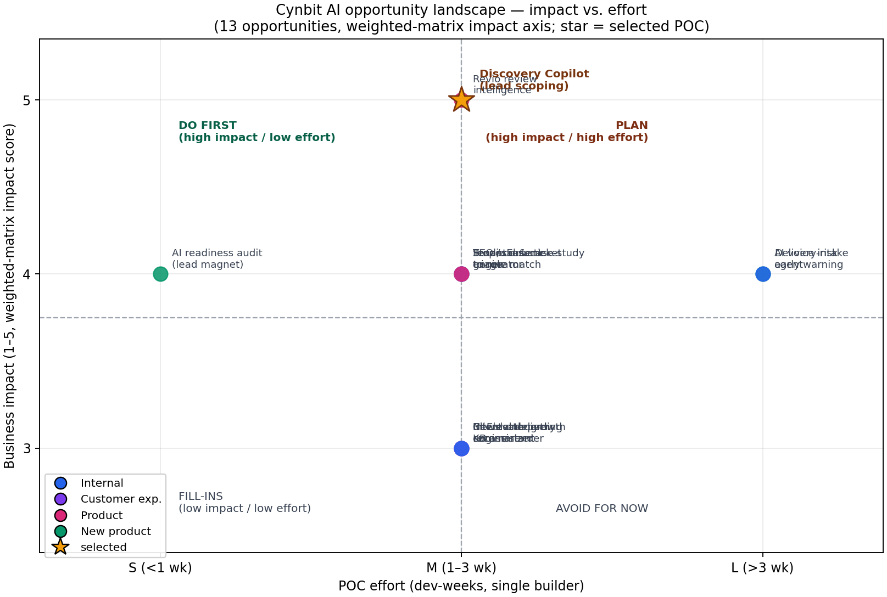

# 01 — AI Opportunity Report for Cynbit Technologies

**Deliverable 1 of 3** · Cynbit AI/ML Engineer Intern challenge · compiled 2026-10-19
Evidence labels: **[Fact]** = verified on Cynbit's public site (snapshot in `data/raw/`, retrieved 2026-10-19) or a cited external source · **[Claim]** = Cynbit marketing statement, unverified · **[Inference]** = this author's reasoning.

---

## 1. Executive summary

Cynbit Technologies is an AI-automation-first services firm in Jaipur whose entire delivery motion begins with an unstructured, human-heavy "Discovery & audit" step **[Fact]**. The single highest-value AI opportunity identified across 13 scored candidates is the **Discovery Copilot: an inbound lead qualification and scoping assistant** that turns free-text inquiries (form, email, WhatsApp, LinkedIn) into a structured brief — service fit, complexity band, effort range, risk flags, and clarifying questions — grounded strictly in Cynbit's published service catalog. It scored **4.80/5.00** on the weighted matrix (business impact 5/5), ahead of Revio review intelligence (4.65) and the SEO content engine (4.25). It attacks documented speed-to-lead economics, automates the one process step every engagement passes through, and is demonstrable end-to-end on a free-tier LLM (Groq since the provider switch, decision.md D-026) with zero private data — the accompanying Streamlit POC runs keyless in Offline Mode.

## 2. Cynbit snapshot

**What they do.** Cynbit positions itself as an "AI automation and software solutions company" in Jaipur, Rajasthan, building "autonomous AI agents, custom software development, and scalable business platforms" **[Fact]**. Three service suites are marketed: (a) AI automation — autonomous agents ("smart AI assistants that manage leads and coordination"), LLM automation of data entry and document handling, AI voice agents, and AI-stack integration; (b) custom IT services — full-stack web/mobile, backend systems, AWS/Azure cloud, legacy migration; (c) digital marketing — Google/Meta performance ads, technical SEO, CRM automation, funnel optimization **[Fact]**.

**How they make money.** The site does not publish pricing. The revenue model is inferable: billable project work (software/cloud/marketing engagements), possibly retainers, plus three proprietary SaaS products — **Cynbit Studio** (edtech "career intelligence" with AI-evaluated coding missions, mock interviews, resume engine, job matcher), **Revio** ("AI-first reputation engine" with cross-platform review sync, AI response drafting, sentiment, crisis detection, multi-location control), and **TenantEase** (property/tenant management with rent tracking and automated reminders) **[Fact]** — whose commercial launch status is not evidenced publicly **[Inference]**. A training arm, **BitElevate**, claims 1000+ certified architects **[Claim]**, and a Manav Seva Trust partnership delivers IT teaching to rural and government schools **[Fact]**.

**Who they serve.** Named clients skew to SMB and mid-market digital businesses — Marketing Addict, Evento, Urban Wardrobe, Cloudy Tales, EContentPrep, Sofiasa, Wild Basil, Pragya Healths, WizHealth, plus EliteVogue, TrendMart, CarePlus Health, GlobalPay in case studies — across retail, events, health, edtech, food, and fintech **[Fact]**. Case-study themes (AI diagnostic triage, IoT patient monitoring, legacy ERP modernization, AR try-on, real-time ticketing, headless commerce) signal an ambition profile well above typical local-agency work **[Fact]**.

**Stated vs. unverified.** Site metrics — 98% retention, 3x ROI uplift, 25k+ newsletter subscribers, 50k+ users handled, 99.9% uptime, "+40% organic leads" — are marketing claims with no published methodology **[Claim]**; this report never builds on them as facts. The team page lists a "Board of Architects" (Founder & CEO, Co-Founder & CTO) without a wider roster, and the careers page recruits business-development and marketing interns **[Fact]** — consistent with a small senior team where sales bandwidth, not engineering, is the bottleneck **[Inference]**.

## 3. Industry context

**AI adoption among the buyers Cynbit serves is rising fast — and unevenly.** US-based survey frames put operational SMB generative-AI use at 55–58% in 2025–26, up from ~40% a year earlier; growing SMBs adopt at 83% versus 55% for declining ones, making AI adoption one of the cleanest growth-correlation signals in SMB technology data (source S3, accessed 2026-10-19). OECD firm-level data is far more conservative — 8.7% (2023) to 20.2% (2025) — because it counts AI inside the production loop only (source S4). India-specific figures land in between: manufacturing MSME adoption around 15% (source S13). The gap between "using ChatGPT" and "production AI in workflows" is precisely the services gap an integrator monetizes **[Inference]**.

**Agencies and IT-services firms are productizing AI internally before selling it.** The 2026 agency landscape shows AI automation shifting from differentiator to hygiene: lead-gen benchmarks report a 73% average increase in qualified leads within six months of AI deployment (vendor-reported, source S6), and ML-based lead scoring is credited with 75% higher conversion versus traditional methods (vendor-reported, source S5). Traditional rule-based scoring accuracy is reported at 15–25%, with AI approaches pushing 40–60% (source S7). Speed is the sharpest documented lever: MIT/InsideSales lead-response research found 100x higher contact odds responding within 5 minutes versus 30, 21x higher qualification odds, and 78% of buyers purchasing from the first responder, while average B2B response times run ~47 hours (sources S8–S9; original studies 2007–2011, directionally repeated since — treated here as directional, not precise).

**Their three product markets are all real and growing.** Review/feedback management software: $16.73B (2025) → $19.56B (2026) (source S10); online reputation management $6.88B → $7.75B over the same span (source S11). India proptech: $1.31B (2025) → $1.47B (2026), 12.26% CAGR to $3.82B by 2034 (source S12). India edtech: $12.1B (2025) → projected $50B by 2035 at 15.24% CAGR (source S13). Where AI creates margin in services and SaaS: (1) compressing pre-sales labor (scoping, proposals) — margin that currently eats senior hours; (2) automating repetitive judgment (ticket triage, review replies) — the core promise of their own products; (3) converting marketing content into compounding SEO assets. Competitive density is highest in review management (Birdeye, Podium, Sprout Social et al.), moderately high in proptech SaaS, and still fragmented for "AI automation agency" positioning in Indian tier-2 cities — Cynbit's home advantage **[Inference]**.

## 4. Opportunity landscape

Thirteen opportunities, grouped by bucket. Each entry: problem · AI approach · data needed · expected impact · effort · risk. Full weighted scoring in `docs/bonus/07_Opportunity_Scoring_Matrix.md`.

### Bucket A — Internal processes

| # | Opportunity | Problem | AI approach | Data needed | Expected impact | Effort | Risk |
|---|-------------|---------|-------------|-------------|-----------------|--------|------|
| A1 | **Discovery Copilot (lead qualification & scoping)** — *selected* | Free-text inquiries arrive across channels; triage/scoping burns senior time; slow first response | Sanitize → classify service fit → extract structured brief → ground on catalog → complexity/effort band → clarifying questions | Synthetic inquiries + public service catalog | Faster, consistent qualification; reusable brief for proposals | M | Estimate accuracy without historical data |
| A2 | Proposal & case-study generator | Proposals take days; case studies rarely get written | Brief-to-proposal drafting grounded in public case studies | Synthetic briefs + site corpus | Days → hours on pre-sales documents | M | Hallucinated credentials; generic prose |
| A3 | SEO / content engine | Technical-SEO and content delivery is labor-heavy | Brief generation, cluster planning, content QA vs. SERP intent | Public SERPs + their blog | 2–3x content throughput **[Inference]** | M | Quality evaluation is subjective; commodity tooling |
| A4 | Delivery-risk early-warning | Project overruns surface late | Classification/trending on project telemetry | **Private — unavailable** | Margin protection | L | No data access in challenge scope |
| A5 | Internal delivery KB assistant | Tribal knowledge locked in chat threads | RAG over internal docs | **Private — unavailable** | Onboarding speed | M | No data access in challenge scope |
| A6 | Newsletter growth engine | 25k+ subscribers **[Claim]** under-monetized | Topic modeling, personalization, subject-line testing | Their public blog | Engagement lift | M | Low demo-ability; privacy considerations |

### Bucket B — Customer experience

| # | Opportunity | Problem | AI approach | Data needed | Expected impact | Effort | Risk |
|---|-------------|---------|-------------|-------------|-----------------|--------|------|
| B1 | Client onboarding status summarizer | "Where are we on my project?" interrupts delivery | Summarization over structured updates | **Private — unavailable** | Fewer status interrupts | M | No data access; low wow-factor |
| B2 | Discovery-form instant responder | Inquiries wait hours for human reply | Instant structured acknowledgment + brief draft | Site catalog + synthetic inquiries | Speed-to-lead 100x-class gains (S8/S9) | S | Overpromising in auto-replies |

### Bucket C — Existing products

| # | Opportunity | Problem | AI approach | Data needed | Expected impact | Effort | Risk |
|---|-------------|---------|-------------|-------------|-----------------|--------|------|
| C1 | Revio review intelligence | Review volumes exceed manual reading; replies uneven | Theme clustering, sentiment, escalation detection, grounded reply drafting | Public review datasets (Yelp/Amazon/Google) | Core product value; $16.7B market (S10) | M | Crowded category; differentiation hard |
| C2 | TenantEase ticket triage | Landlords drown in chat-format maintenance requests | Intent + urgency classification, routing, lease Q&A | Synthetic tickets | Core product value; India proptech 12.26% CAGR (S12) | M | Product not evidenced as launched |
| C3 | Cynbit Studio resume-to-role matching | Learners can't map skills to market demand | JD parsing, skill-gap extraction, evidence-grounded guidance | Public job descriptions | Employability proof for flagship edtech | M | Job-data licensing; staleness |
| C4 | BitElevate learning-path recommender | Generic paths; drop-off risk | Sequence recommendation + project feedback rubric | Synthetic learner journeys | Retention for training arm | M | Cold-start; weak eval ground truth |

### Bucket D — New future products

| # | Opportunity | Problem | AI approach | Data needed | Expected impact | Effort | Risk |
|---|-------------|---------|-------------|-------------|-----------------|--------|------|
| D1 | Productized "AI readiness audit" | SMBs want AI, don't know where to start; Cynbit's funnel needs a lead magnet | Guided assessment → scored report → matched services | Public SMB frameworks | New top-of-funnel asset | S | Scoring validity; me-too risk |
| D2 | AI voice intake agent | Phone inquiries missed outside hours; they already market AI voice agents (Fact) | STT → pipeline (A1) → TTS draft | Synthetic call transcripts | 24/7 intake; matches marketed capability | L | Live-voice quality; latency cost |

## 5. Prioritization

Weighted scores (impact 30% · feasibility 25% · data 20% · demo 15% · fit 10%):

| Rank | Opportunity | Bucket | Impact | Feas. | Data | Demo | Fit | **Weighted** |
|------|-------------|--------|--------|-------|------|------|-----|-----------|
| 1 | Discovery Copilot (A1) | Internal | 5 | 5 | 4 | 5 | 5 | **4.80** |
| 2 | Revio review intelligence (C1) | Product | 5 | 4 | 5 | 5 | 4 | **4.65** |
| 3 | SEO / content engine (A3) | Internal | 4 | 5 | 4 | 4 | 4 | **4.25** |
| 4 | Studio resume-to-role (C3) | Product | 4 | 4 | 4 | 4 | 4 | **4.10** |
| 5 | Proposal generator (A2) | Internal | 4 | 5 | 3 | 4 | 4 | **4.05** |
| 6 | TenantEase ticket triage (C2) | Product | 4 | 4 | 4 | 4 | 3 | **3.90** |
| 7 | AI readiness audit (D1) | New | 4 | 4 | 3 | 4 | 5 | **3.90** |
| 8 | AI voice intake (D2) | New | 4 | 3 | 3 | 3 | 5 | **3.50** |
| 9 | Internal delivery KB (A5) | Internal | 3 | 4 | 2 | 3 | 3 | **3.25** |
| 10 | BitElevate recommender (C4) | Product | 3 | 4 | 3 | 3 | 3 | **3.25** |
| 11 | Delivery-risk warning (A4) | Internal | 4 | 3 | 2 | 3 | 4 | **3.20** |
| 12 | Newsletter engine (A6) | Internal | 3 | 4 | 3 | 2 | 3 | **3.10** |
| 13 | Onboarding summarizer (B1) | Customer | 3 | 4 | 2 | 3 | 3 | **3.05** |

The 2×2 shows the Discovery Copilot alone in the "do first" quadrant at impact 5 with medium effort; the voice agent and delivery-risk warning sit in "plan" (high effort); KB/onboarding/newsletter fall into fill-ins blocked by private-data needs.

## 6. Selected opportunity in depth: the Discovery Copilot

**User.** The primary user is whoever fields inbound demand at Cynbit — founder, BD intern (they are actively recruiting one **[Fact]**), or a senior architect pulled into pre-sales **[Inference]**. Secondary users: the delivery lead who inherits the engagement, and the prospect, who gets a faster, more competent first reply.

**Pain point.** Every channel (contact form, `opportunities@cynbit.in`, LinkedIn DMs, WhatsApp, referrals) delivers unstructured text of wildly varying quality — from one-liners to pasted RFPs. Qualifying one inquiry means reading, mapping to services, guessing complexity, and drafting follow-up questions — 15–45 minutes of senior time per lead **[Inference — no internal data; consistent with a small team recruiting BD interns]**. Meanwhile the documented decay curve on lead response (contact odds 100x higher inside 5 minutes; 78% of buyers choose the first responder; source S8) means every hour of delay has measurable cost. Cynbit's own site promises agents that "manage leads and coordination" **[Fact]** — but there is no evidence of an internal tool doing this today **[Inference]**.

**Current workflow (inferred, labeled).** Inquiry arrives → sits until someone senior is free → manual read → ad-hoc service mapping from memory → back-and-forth email clarifications over days → a discovery call is scheduled or the lead quietly cools. Inconsistency is unmeasured and unbudgeted **[Inference]**.

**Proposed workflow.** Inquiry arrives (any channel) → **sanitize** (PII masking, injection screening, length/language checks) → **classify** service fit against the real catalog (AI automation / software dev / cloud / SEO-marketing / out-of-scope) → **extract** a structured brief (goal, deliverables, timeline signal, budget signal, industry, tech constraints) → **ground** every service match in retrieved catalog evidence → **estimate** complexity (S/M/L) and effort range with confidence → **question** — generate prioritized clarifying questions → **validate** (Pydantic schema + business rules, human-review flag) → render as review cards. Output is a draft for a human, never an auto-sent quote. This is exactly the POC shipped in this repository (`app/streamlit_app.py`).

**Success metrics and KPIs** (targets for a real pilot, honest about current measurement limits — see §7):

| KPI | Baseline | Pilot target | Measurement |
|-----|----------|--------------|-------------|
| First-response time to inquiry | Unknown (assumed hours) **[Inference]** | < 5 minutes for structured acknowledgment | Email/form timestamps |
| Senior time per qualification | 15–45 min **[Inference]** | < 5 min review of copilot brief | Time tracking, 2-week A/B |
| Service-routing accuracy | n/a | ≥ 85% top-1 on labeled sample | Eval harness on real inquiries after anonymization |
| Complexity-band accuracy (S/M/L) | n/a | ≥ 70% exact-band, ≥ 90% adjacent-band | Same |
| Clarifying-question usefulness | n/a | ≥ 60% of questions judged "ask-worthy" by BD | Weekly human review sheet |
| Schema-validity of briefs | n/a | ≥ 99% parseable structured output | Automatic |
| Injection/PII incidents | 0 tolerated | 0 | Automatic + audit |

## 7. Risks and limitations

1. **Cynbit internal data was not accessible.** All performance numbers in this submission are measured on clearly-labeled synthetic data. Headline accuracy must be re-validated on a real, anonymized inquiry sample before any production claim.
2. **The volume assumption is unverifiable.** If inbound is referral-only and tiny, ROI concentrates elsewhere; the cost model (`docs/bonus/04_ROI_and_Cost_Model.md`) is parameterized 50–2,000 inquiries/month so the reviewer can substitute reality.
3. **Estimate fidelity.** Without historical project cost data, complexity estimates are heuristic banding, not pricing. The UI labels them "draft, not a quote," and the human-review flag is mandatory below a confidence threshold.
4. **Prompt injection.** Lead text is untrusted input; the eval set includes injection attempts and the sanitizer quarantines instructions embedded in inquiries (pass rate reported in `evals/results/`).
5. **Hallucination risk to prospects.** Mitigated architecturally: any factual statement about Cynbit's services must trace to the retrieved catalog; missing information becomes a clarifying question instead of an invented answer.
6. **Red-team summary** (full pass in the scoring-matrix doc): weakest assumption = inbound volume; skeptical-CTO objections = mispricing trust and "a structured form would suffice" — both answered by range-plus-flag output design and the rules-vs-pipeline ablation; production killers = injection, PII logs, auto-send overreach — all addressed or disclosed.
7. **Model/platform dependency.** Free-tier rate limits could throttle peak intake (Groq free tier: 30 RPM / 1K requests/day / 8K tokens-min per model, verified 2026-10-20); Offline Mode degrades gracefully but produces rule-based output, and the mode badge makes that impossible to miss.

## 8. Recommended roadmap

A 30/60/90-day pilot-to-production plan with success gates and owners (roles) is in `docs/bonus/08_Rollout_Roadmap_30_60_90.md`. Shape: 30 days — shadow-mode logging on real inquiries, offline validation, human-review protocol; 60 days — assisted mode for BD, feedback loop wiring, eval re-run on real labeled sample; 90 days — integration into form/email ingestion with human-in-the-loop send, monitoring dashboards, and a go/no-go gate on measured KPIs.

## 9. Sources

All accessed 2026-10-19 unless noted.

**Cynbit public site (snapshots in `data/raw/`):**
S1. https://www.cynbit.in/ — positioning, lifecycle, metrics claims, client logos, contact.
S2. https://www.cynbit.in/services — service suites, "agents that manage leads", tech stack.
S2b. https://www.cynbit.in/products · /case-studies · /story · /team · /careers · /impact · /bitelevate · /bitelevate/paths · /diaries · /blog · /contact · /privacy · /terms — product facts, case studies, careers, team.
S2c. Blog posts: /blog/ai-agents-business-operations (pub. 2025-10-13) · /blog/best-crm-automation-strategies · /blog/small-business-ai-automation · /blog/ai-digital-marketing-revolution · /blog/ai-powered-business-guide.

**Market and benchmarks:**
S3. presenc.ai/research/smb-ai-adoption-statistics-2026 (May 2026) — SMB AI adoption 55–58%; growing vs declining 83%/55%; frame analysis.
S4. oecd.org, "AI adoption by small and medium-sized enterprises" (Dec 2025); omago.ai summary — OECD 8.7%→20.2% firm-level.
S5. landbase.com/blog/lead-scoring-statistics (Jan 2026) — ML lead scoring +75% conversion (vendor-reported).
S6. thestarrconspiracy.com/insights/benchmarks/ai-lead-generation-benchmarks-2025 (Sep 2026) — +73% qualified leads in 6 months (vendor-reported).
S7. warmly.ai/p/blog/ai-lead-scoring (Mar 2026) — traditional 15–25% vs AI 40–60% scoring accuracy (vendor-reported).
S8. MIT/InsideSales Lead Response Management study (Oldroyd) + HBR "The Short Life of Online Sales Leads" (2011), compiled at caseyresponse.com/blog/lead-response-time-statistics (2026) — 100x/21x/78%/47h figures; original research 2007–2011, treated as directional.
S9. voiso.com/articles/lead-response-time-metrics (2026) — secondary corroboration of the 5-minute rule.
S10. thebusinessresearchcompany.com, Feedback and Reviews Management Software Global Market Report — $16.73B (2025) → $19.56B (2026).
S11. mordorintelligence.com, Online Reputation Management Market (Jan 2026) — $6.88B → $7.75B.
S12. imarcgroup.com/india-proptech-market (Sep 2026) — India proptech $1.31B → $1.47B, 12.26% CAGR; grandviewresearch.com India proptech outlook — $1.56B (2025).
S13. marketresearchfuture.com, India Edtech Market (Sep 2026) — $12.1B (2025) → $50B (2035); imarcgroup.com/edtech-market (Oct 2026) — global $279.8B → $320.7B; D&B "Business Enterprises of Tomorrow" MSME report — ~15% manufacturing MSME AI adoption.
S14. GLM free tier (historical, provider at build time): aibase.com/news/11323 (Aug 2024, glm-4-flash free); z.ai model-API pricing; docs.litellm.ai/docs/providers/zai (glm-4.5-flash FREE).
S15. Groq API (live provider since 2026-10-20, user-instructed switch — decision.md D-026): console.groq.com/docs/models (production models + pricing, accessed 2026-10-20); console.groq.com/docs/deprecations (llama-3.1-8b-instant and llama-3.3-70b-versatile deprecated 2026-08-16); console.groq.com/docs/rate-limits (free tier: 30 RPM / 1K RPD / 8K TPM / 200K TPD per model).

Vendor-reported benchmarks (S5–S7) are directionally useful but methodologically opaque; they inform prioritization, not promises.
