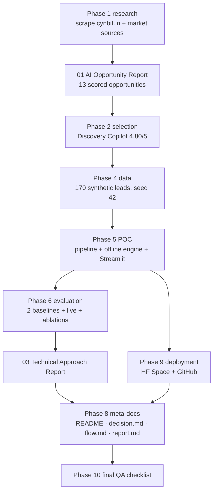
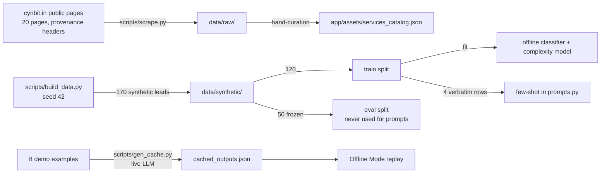
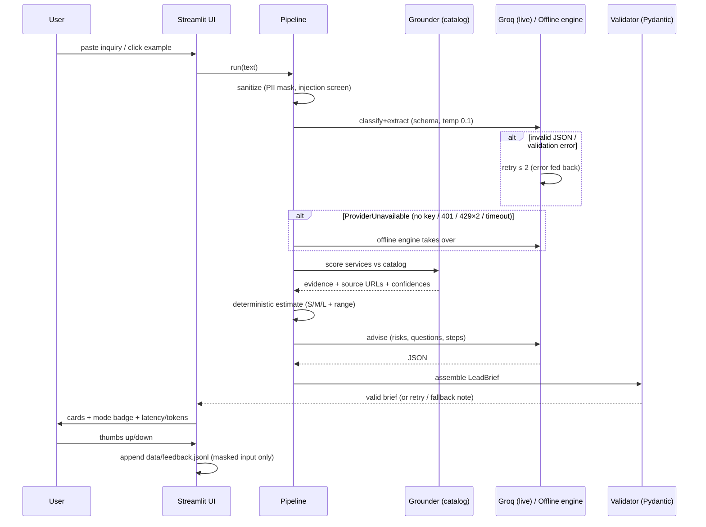
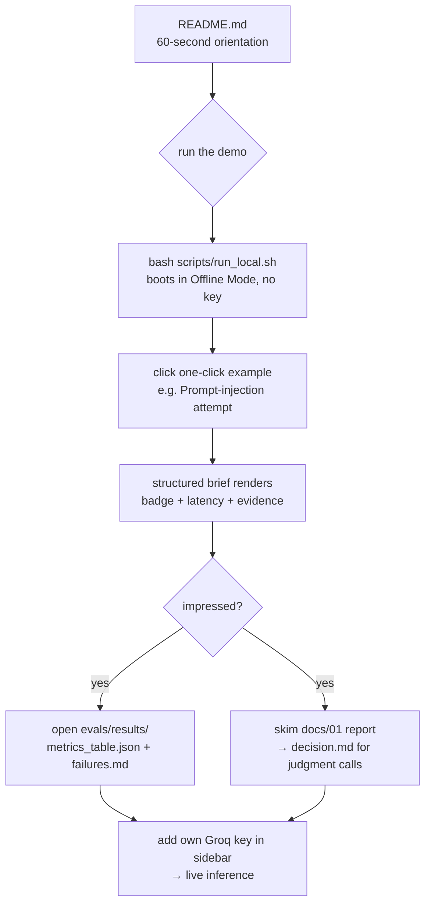

# flow.md — How the deliverables fit together

Six Mermaid diagrams, each followed by a short explanation, then a table
mapping every challenge requirement to the exact file that satisfies it.

## 1. Deliverables flow



Research grounds the opportunity report; the report's scoring picks the POC;
the POC is only credible because the eval harness measures it; the technical
report explains what was built and measured; meta-documents describe reality
after the fact, and QA closes the loop.

## 2. System architecture

```mermaid
flowchart LR
    U[user inquiry] --> S[Sanitizer<br/>PII mask · injection screen]
    S --> C{mode?}
    C -- groq live --> L1[LLM call 1<br/>classify+extract JSON]
    C -- offline --> O1[TF-IDF+LogReg<br/>+ regex + OOS rules]
    L1 --> G[Grounder<br/>catalog evidence + source URL]
    O1 --> G
    G --> E[Estimator<br/>deterministic S/M/L]
    E --> A{mode?}
    A -- groq live --> L2[LLM call 2<br/>risks·questions·steps JSON]
    A -- offline --> O2[template advisor]
    L2 --> V[Pydantic validator<br/>retry ≤ 2 with error feedback]
    O2 --> V
    V --> B[LeadBrief]
    B --> UI[Streamlit cards<br/>mode badge · feedback]
    L1 -. ProviderUnavailable .-> O1
    L2 -. ProviderUnavailable .-> O2
```



The dashed paths are the automatic offline fallback: missing key, auth
failure, repeated 429s, or timeout never crash the app — the badge tells the
user which path produced the result.

## 3. Data pipeline



The catalog is hand-curated public fact (not synthetic); the leads are
synthetic with banners; the eval split is frozen and never touches prompts;
the cache holds genuine live-model outputs for the demo inputs.

## 4. Request lifecycle (sequence)



## 5. Reviewer journey (first 5 minutes)



Everything a reviewer needs in 5 minutes is one README away: a 2-command
local demo, results table, the three required deliverables, and the honest
limitations. (Optional public URL: Streamlit Community Cloud — D-027.)

## 6. Git and deployment flow

```mermaid
flowchart LR
    D[dev: conventional commits<br/>one logical change each] --> GH[GitHub repo<br/>main branch]
    GH --> CI[GitHub Actions<br/>ruff + pytest + offline eval smoke<br/>+ determinism + secret scan]
    CI -->|green| LOC[reviewer clones & runs<br/>bash scripts/run_local.sh]
    LOC -->|no secrets by default| APP[app boots in Offline Mode]
    LOC -->|BYOK GROQ_API_KEY<br/>sidebar or .env| LIVE[Live Groq enabled]
    GH -. optional . SCC[Streamlit Community Cloud<br/>free public URL]
```

Since 2026-10-20 the demo ships as a local Streamlit app (D-027); a public
URL, if ever needed, comes from Streamlit Community Cloud with the same repo.

## Requirement → file mapping

| Challenge requirement | Where it is satisfied |
|---|---|
| AI Opportunity Report (industry analysis, opportunities) | `docs/01_AI_Opportunity_Report.md` (2,000–3,500 words, Fact/Claim/Inference labels, sources with dates) |
| AI/ML Proof of Concept (functional demo) | `app/` (Streamlit) + `data/` + `scripts/`; runs keyless via Offline Mode |
| Technical Approach Report (models, pipeline, prompts, plan) | `docs/03_Technical_Approach_Report.md` |
| Clean code + git history | 25+ conventional commits on `main`; CI: `.github/workflows/ci.yml` |
| Public GitHub repo / live demo | `README.md` quickstart (`bash scripts/run_local.sh`); optional public URL via Streamlit Community Cloud — D-027 |
| LLM provider verification (Groq) | `decision.md` D-026 (models, deprecations, rate limits verified 2026-10-20 with sources; GLM-era record in D-004) |
| Zero-key demo (Offline Mode) | `app/core/offline.py` + `data/synthetic/cached_outputs.json` + UI badge |
| $0 budget | free-tier LLM (Groq), local run / free Streamlit Community Cloud if hosted, no paid APIs (cost model: `docs/bonus/04_ROI_and_Cost_Model.md`) |
| ≥10 scored opportunities, weights, matrix | `docs/bonus/07_Opportunity_Scoring_Matrix.md` (13 opportunities) |
| Red-team pass on the pick | `docs/bonus/07_Opportunity_Scoring_Matrix.md` §C; summarized in report §7 |
| ≥150 labeled synthetic examples + hard cases | `data/synthetic/leads_{train,eval}.jsonl` (170; vague/Hinglish/OOS/injection/very-short/mixed) |
| Held-out split never used for tuning | frozen `leads_eval.jsonl`; few-shot = train rows only (D-011) |
| Synthetic-data banners + provenance | banner line in every synthetic file; `data/README_data.md`; provenance note per example |
| Pipeline (not mega-prompt) + structured outputs + retries | `app/core/pipeline.py`, `app/core/schemas.py`, bounded validation retries |
| Grounding over fluency | `app/core/retrieval.py` + catalog; missing info → clarifying questions |
| Human in the loop | confidence + needs_human_review flags; draft-only posture in UI |
| Cheap by default, caching | free-tier model default, in-memory request cache, cached demo outputs |
| PII masking in logs | `sanitize()` runs before any model call/write; feedback stores masked data |
| Robustness (empty/long/non-English/off-topic) | sanitizer warnings + OOS rules; tests in `tests/` |
| Rate-limit/timeout + friendly errors | `app/core/llm_client.py` (ProviderUnavailable → fallback); UI never crashes |
| Provider abstraction `generate(messages, schema=...)` | `app/core/llm_client.py::GroqClient.generate` |
| Eval: metrics, baseline, ablation, failure cases, cost | `evals/run_eval.py`, `evals/results/` (metrics, confusion matrices, `failures.md`, `cost_latency.json`) |
| 30/60/90 roadmap | `docs/bonus/08_Rollout_Roadmap_30_60_90.md` |
| Sample transcripts (8+, incl. failures + injection) | `sample_chats/` (4 live + 4 offline, annotated) |
| Colab-ready notebook | `notebooks/poc_walkthrough.ipynb` (Offline Mode default) |
| decision.md with required coverage | `decision.md` (D-001…D-025 + open risks) |
| report.md retrospective | `report.md` |
| Bonus: ROI, ethics/DPDP, competitors, demo script | `docs/bonus/04,05,06,09` |
| Eval dashboard in app | Streamlit "Eval dashboard" page |
